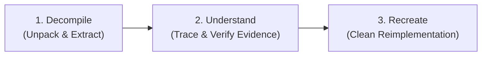

# REA (Reverse Engineer Anything) Guide

A comprehensive guide for AI agents using **REA (Reverse Engineer Anything)** ([rea.tools](https://rea.tools) / [`morluto/rea`](https://github.com/morluto/rea)) via the **REA MCP Server** (`rea`) and the **`rea-agents` CLI**.

---

## 🧭 The Core Workflow: Decompile → Understand → Recreate

REA structures reverse engineering into an evidence-driven, three-phase discipline:



1. **Decompile**:
   - Extract files, modules, preload scripts, and symbol tables from packaged applications (e.g. Electron ASAR, ZIP, APK, IPA, or native binaries).
2. **Understand**:
   - Locate entry points, IPC channels (`ipcRenderer` / `ipcMain`), network request endpoints, and internal state flows.
   - Produce structured findings backed by verifiable evidence rather than guessing.
3. **Recreate**:
   - Translate the recovered logic into a clean, modern, native implementation matching the user's current project architecture and tech stack.

---

## 🛠️ MCP Integration & Tool Usage

When the `rea` MCP server is enabled in `~/.gemini/config/mcp_config.json`:

```json
{
  "mcpServers": {
    "rea": {
      "command": "npx",
      "args": ["-y", "rea-agents"]
    }
  }
}
```

The agent gains access to REA's MCP tool suite to perform structured inquiries on target files:

### Target Formats & Support
* **JavaScript & Electron Applications**:
  - Direct static analysis of unpacked source trees, Electron app directories, and `.asar` archives.
  - Extracts module maps, dependencies, IPC communication contracts, and web assets without executing untrusted code.
* **Native Binaries (Mach-O, ELF, PE)**:
  - Static structural inspection, string extraction, and decompilation bridges (compatible with Ghidra, Hopper, and IDA Pro).
* **Package Archives**:
  - Explores and indexes container structures (ZIP, ASAR, APK, IPA).

---

## 💻 CLI Commands & Quick Recipes

In addition to MCP tools, the `rea-agents` CLI is available in the Web Terminal and automated scripts:

### 1. Direct Static Analysis of JavaScript / Electron Apps
Run zero-config analysis directly against an extracted application directory or ASAR archive:
```bash
npx -y rea-agents@latest analyze-javascript-application /path/to/extracted/app --json
```

Always use `--json` when invoking `rea-agents` in automated scripts to obtain parseable structured data.

### 2. Unpacking Electron `.asar` Files
If the target is a packaged Electron application, unpack the archive before deep analysis:
```bash
# Using npx asar directly
npx asar extract /path/to/app.asar /tmp/extracted-app
```

### 3. Inspecting Strings & Architecture of Native Binaries
For native Linux ELF or cross-platform binaries:
```bash
file /path/to/binary
readelf -h /path/to/binary
strings -a /path/to/binary | grep -E "https?://|api/|secret|token" | head -n 50
```

---

## 📋 Evidence v2 Standards & Reporting Guidelines

When communicating reverse-engineering findings to the user:

1. **Cite Verifiable Evidence**:
   - Always reference exact file paths, function names, IPC channel strings, or byte offsets found during extraction.
2. **Explicit Confidence & Unknowns**:
   - Clearly delineate between **verified facts** (e.g. *"IPC channel `download-file` is registered in `main.js:142`"*), **probable inferences**, and **unknowns/limitations** (e.g. *"Native module `libcrypto.so` is obfuscated and was not disassembled"*).
3. **Clean-Room Reimplementation**:
   - Never output verbatim chunks of proprietary, copyrighted decompiled source code into the user's project.
   - Summarize the algorithm, contract, or architecture, and implement a fresh, idiomatic version conforming to the current codebase standards.
